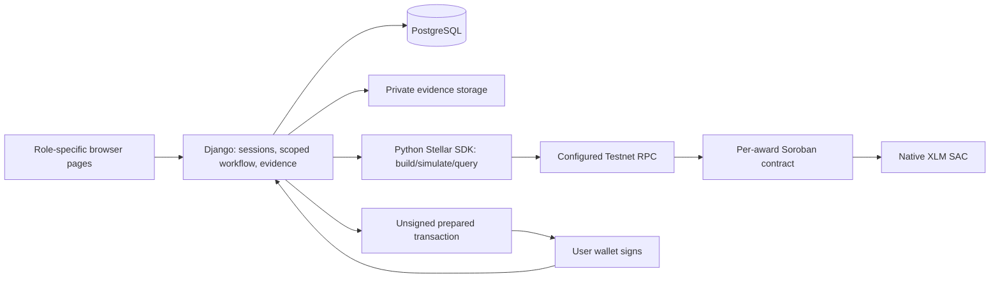

# ProofPay System and Implementation Plan

> **For agentic workers:** Read all four handoff documents first. Use the available executing-plans skill to implement task-by-task after the user authorizes implementation. Subagent-driven execution is an alternative only when authorized. Checkboxes below are future work, not completed work.

**Goal:** Demonstrate a funded training stipend paid exactly once after independent verification, with private evidence and recoverable unpaid Testnet funds.

**Architecture:** One original Django web application plus a small browser wallet-signing bundle and one original Soroban contract type, deployed once per award. Application database holds private workflow/evidence; network-confirmed contract state controls funds. There is no custom RPC server, microservice mesh, AI service or pooled cross-award balance.

**Tech Stack:** Python 3.13; Django 5.2 LTS (5.2.19 baseline); `stellar-sdk==17.0.1`; PostgreSQL 17; server-rendered HTML/CSS; browser `@stellar/freighter-api` 6.0.1 (compatibility gate); Node 24 LTS for bundling only; Rust >=1.92 with Soroban SDK `=28.0.0` baseline and committed Cargo.lock. Versions are the proposed build baseline, not a claim that the app has been built.

**Spec:** [Product and scope](ProofPay_Product_and_Scope.md). [Repository findings](ProofPay_Repository_Validation.md) identify inspected patterns and actual checks. [Agent checklist](ProofPay_Agent_Handoff_and_InstaAward_Checklist.md) governs claims and grant submission readiness.

## Global constraints

- Testnet only; native Testnet XLM via SAC; seven decimals; stipend exactly 200,000,000 base units.
- One workshop program, up to 10 recipients; one condition and one award contract per recipient. No real recipients or money.
- No AI, public signup, Mainnet, fiat cash-out, vouchers, fee sponsorship or stored wallet secrets.
- Sponsor, verifier and recipient are distinct provisioned users and distinct classic G-addresses for each award. Only their wallet signatures authorize chain actions.
- No arbitrary user-supplied RPC/file-fetch URLs or payout addresses. Constructor-bound payee/token/amount are immutable.
- Private evidence and source records remain off-chain; every download checks award/program membership. No generic public media directory.
- Preserve upstream licenses/notices for any copied snippets. Never adopt Aid-flow/Aidflow's placeholder enforcement.
- Use integer base units throughout; HTTP transmits amounts, versions and ledger timestamps as decimal strings. Never use binary floats for asset accounting.
- Use the ledger's UTC timestamp for contract deadlines, timezone-aware UTC application storage, and Asia/Singapore display with explicit timezone.

## Review focus

1. A stale signed approval must not become valid after evidence/verifier changes: Task 2 pins version/revision tests.
2. Timeout, browser refresh and two workers must not pay twice: Task 4 pins idempotent reconciliation tests.
3. Private file access must not widen merely because a user logged in or guessed an ID: Task 3 pins object-authorization tests.
4. A held/rejected award must remain refundable after its deadline, including missing verifier: Tasks 2/5 pin recovery tests.
5. Rotation, Testnet reset or archived contract data must never be interpreted as a fresh unpaid/new award: Tasks 2/5 pin restore/reset tests.

## 1. Deployment and data boundaries



The diagram's RPC-to-contract path represents network execution of submitted transactions. The browser never authorizes by posting a wallet address alone.

Local development: Python virtual environment, PostgreSQL container, Django dev server and browser extension in Testnet mode. Node only builds the wallet JS bundle; do not introduce a Node API. Staging assumption: one Linux app instance behind HTTPS with managed PostgreSQL and a private persistent volume/object store. Use Django's supported deployment server; do not expose `runserver`. Exact hosting provider and spending limits are not chosen; local demo needs no paid account. Never place evidence in an ephemeral deployment filesystem.

Use Django authentication, secure HTTP-only session cookies, CSRF on writes, password validators and bounded login attempts (5 failed attempts per account/IP pair in 15 minutes, backed by database records for this low-volume demo). Staff provisions accounts; users change their initial password on first login. No production hard-coded password or demo backdoor. Demo seeding generates passwords locally without committing them. Site admin is not a fund custodian.

Application role mapping is provisioned and audited. Browser-selected addresses must match the logged-in user's assigned address and intended award role. A chain signature proves wallet authority; it does not prove a natural person's identity. No separate homemade wallet-login protocol is required for v1.

## 2. Proposed application data model

These are new ProofPay models, not upstream models claimed to exist. Use Django migrations, database constraints, indexed foreign keys and short database transactions. Do not make RPC calls while holding row locks. No Supabase service or direct client database access is required.

| Model | Required fields and constraints |
|---|---|
| User | Django user/password/session functionality; no chain secret field |
| Program | UUID, title, requirements_text, requirements_version, sponsor_user, verifier_user, claim/review/payout UTC deadlines, created_at; freeze requirements/deadlines once first award is deployed |
| ProgramMember | program FK, user FK, role, public_wallet, active; unique(program,user); enforce distinct role users/wallets when creating awards; provisioned addresses immutable once referenced by an award |
| Award | UUID, program FK, sponsor_member/verifier_member/recipient_member FKs, contract_id unique nullable until deployment, network_id, code_hash, token_id, base_units integer, current snapshot/status/version, last_confirmed_ledger; unique(program,recipient); fixed 200000000 base units; never delete funded awards |
| EvidenceVersion | UUID, award FK, revision positive integer, random 32-byte nonce, private manifest/files, digest, author FK, created_at; unique(award,revision); immutable once signed; corrected version is a new row |
| ReviewAction | award FK, evidence FK, action enum, private rationale, verifier FK, source_check_method, created_at, chain_operation FK nullable; append-only; an off-chain requested decision is not a confirmed approval |
| ChainOperation | UUID, award FK, actor FK, action enum, expected_contract_version, idempotency_key, unsigned transaction hash/body, signed_hash, status, error_code, last_checked_ledger, created_at; unique(actor,idempotency_key), signed_hash unique when present |
| AuditEvent | program/award FK, actor FK nullable, event type, minimal non-PII payload, chain hash nullable, timestamp; append-only application events |
| DisputeRequest | award FK, claimant FK, reason/private evidence reference, opened/closed timestamps, resolution; no authority to reverse a settled payment |
| LoginAttempt | salted account/IP bucket digest, time and result; purge expired throttle records; never log passwords |

Use BigIntegerField for this fixed small base-unit amount, UUIDField for opaque IDs, timezone-aware DateTimeFields, and TextFields only where necessary. Enforce positive amount and distinct membership constraints in model/service tests and the contract; DB constraints for foreign keys/unique records remain necessary. Querysets must be scoped before object lookup. Return 404 for unrelated private objects.

Program's verifier is the initial default, not permanent authority for every award. For private downloads and actions, use the **award's current verifier membership**. Provision a proposed replacement without granting award access; update its award membership and remove the old verifier's access only after confirmed on-chain replacement. Retain the old reviewer's identifier in audit history. A failed/unknown rotation must not prematurely switch authority or expose files to the proposed replacement. An incoming old-verifier action still faces the contract version/role checks.

Evidence policy: at most 3 files of 5 MiB each per version; allow PDF/JPEG/PNG only, inspect content signatures, reject mismatched/HTML/SVG/executables, randomize storage names, strip path components, escape displayed names, serve only as attachment with `nosniff` from authenticated endpoints. No URL imports, archive extraction or rendering uploaded PDF/HTML inline. Plain text explanation capped at 2,000 characters. Basic type checks do not replace a malware scanner; publicly enrolling real users requires a scanner/isolated review environment and another security review.

Manifest format: UTF-8 compact JSON with sorted keys, schema `proofpay-evidence-v1`, award UUID, revision, nonce hex, file SHA-256 digests, private source reference and the submitted explanation. Backend computes SHA-256 of exact canonical bytes; stores manifest privately; recipient previews its human summary and signs submission of digest/revision. Nonce prevents simple guessing of low-entropy records. The digest still does not prove truth. Backend verifies evidence integrity again on review/export. Avoid personal or sensitive text in chain arguments/events.

## 3. Contract design: one fixed award

All interfaces below are **new proposed ABI**, not calls available in any reused repo. Deploy immutable code (no upgrade entry point) with constructor parameters. Source account of each transaction is the required signer; no arbitrary relayer/auth-entry scheme in v1.

### Immutable constructor terms

`__constructor(env, sponsor: Address, verifier: Address, recipient: Address, token: Address, amount: i128, award_id: BytesN<32>, policy_hash: BytesN<32>, claim_deadline: u64, review_deadline: u64, payout_deadline: u64)`

On-chain validate three distinct classic account addresses, amount == 200000000, nonzero random award ID and policy commitment, and `now < claim_deadline < review_deadline < payout_deadline`. Sponsor requires auth. Hash program terms plus random policy nonce; retain bytes privately. No public names, attendance references or evidence URLs.

The application deployment gate derives the native SAC ID for the configured Testnet, checks its built-in executable/identity and refuses another token or network. The contract binds the supplied token forever; it does not establish asset identity merely from `symbol()`. Only contracts deployed through the verified manifest/code-hash gate appear as valid ProofPay awards. Do not accept arbitrary user-provided contracts as equivalent awards. Native-token provenance must also be checked in the live Testnet acceptance test.

Default demo windows: claim at creation +7 days, review +9 days, payout +10 days. Operator sees and accepts exact deadlines; they are immutable after deployment. Shorter clocks are allowed only in explicitly labeled expiry-test fixtures, preserving ordering. All boundary checks below use ledger time, not the browser clock.

### Contract record

One instance record stores terms, status, monotonic `version: u64`, `evidence_revision: u32`, latest digest, approver/digest/revision when approved, sponsor_hold, verifier_hold and confirmed payment/refund state. Version increments on every successful mutation. A funded flag distinguishes funds ever deposited; only one exact `fund()` succeeds. Enforce checked arithmetic.

| Status | Meaning |
|---|---|
| Created | Deployed, not funded |
| Funded | Exact payment deposited, no submitted evidence |
| Submitted | Recipient signed a particular evidence version; awaiting decision |
| Approved | Verifier approved the exact current digest/revision |
| Rejected | Verifier rejected; unpaid; appeal may be reopened before review cutoff |
| Paid | Terminal: fixed amount transferred to immutable recipient |
| Refunded | Terminal: unpaid deposit returned to original sponsor after expiry |
| Cancelled | Terminal: sponsor cancelled before funding |

### Methods and transition rules

Every mutator after construction takes `expected_version: u64`; mismatch returns `StaleVersion` before any transfer. Every method checks current state and signer on-chain even when the web UI already checked it. Use `#[contracterror]` error enums; no success placeholders.

| Proposed method | Actor / preconditions | Effect |
|---|---|---|
| `fund(expected_version)` | Sponsor auth; Created; now <= claim deadline | Transfer exact amount sponsor -> contract; Funded |
| `cancel(expected_version)` | Sponsor auth; Created only | Cancelled, no funds moved |
| `submit(revision: u32, digest: BytesN<32>, expected_version)` | Recipient auth; Funded or Submitted; now <= claim deadline; revision == prior+1; nonzero digest | Submitted; store exact new commitment; clear previous approval, preserve holds |
| `approve(expected_version)` | Current verifier auth; Submitted; now <= review deadline; no holds | Approved; bind approval to current evidence hash/revision and verifier |
| `reject(expected_version)` | Current verifier auth; Submitted or Approved; now <= review deadline | Rejected; clear approval; preserve evidence/history in events; allowed while held |
| `reopen(expected_version)` | Current verifier auth; Rejected or Approved; now <= review deadline | Submitted, clear approval; recipient can revise only before claim deadline |
| `set_hold(actor: Address, held: bool, expected_version)` | actor is sponsor or current verifier and authorizes; funded nonterminal status | Set only that role's hold flag; may set/clear even after review deadline; cannot extend deadlines |
| `replace_verifier(new: Address, expected_version)` | Sponsor auth; nonterminal status; now <= review deadline; new differs from sponsor/recipient/old | Replace verifier, emit old/new; clear approval and verifier hold; Approved/Rejected -> Submitted; other status unchanged; sponsor hold retained |
| `pay(expected_version)` | Sponsor auth; Approved; now <= payout deadline; no holds; stored approval matches current verifier/evidence | Mark Paid then transfer exact amount contract -> recipient atomically |
| `refund(expected_version)` | Sponsor auth; Funded/Submitted/Approved/Rejected; now > payout deadline | Refunded then exact original deposit -> sponsor; ignore holds; no verifier required |
| `get_state()` | Public read | Return non-PII terms/status/version/commitments; no private evidence |
| `extend_lifetime()` | Anyone may pay fee; initialized instance exists | Extend instance TTL only; no business-state change |

Rejected/held states do not prevent refund. Funds cannot be withdrawn early merely because the sponsor lost interest. There is no partial payment/refund. Extra direct transfers to the contract are unsupported; the app constructs only `fund()` and warns not to send assets manually. No generic arbitrary-withdraw/sweep function is provided in this prototype.

State update and token transfer occur in the same Soroban invocation: if transfer fails, the full invocation must roll back. Test this; do not assume an off-chain paid flag repairs an on-chain failure. Only one `pay`/`refund` can win even under concurrent requests. Do not reuse a balance/claim identifier after a terminal state.

Initialize roles in the constructor to avoid a separate initialization race. Maintain instance TTL on successful writes and through `extend_lifetime`; inspect current network TTL bounds rather than hard-coding assumptions about days per ledger. Code/instance archival must be restorable; an absent/archived record is **not** Created. Persist contract ID/WASM hash off-chain, restore through supported SDK/CLI mechanisms and re-read state before attempting an action. No terminal-state deletion. No automatic redeployment following lookup failure.

### Operational trust and compromise

Sponsor rotation of verifier invalidates prior approval and any old signed action through the version check. The old key has no future authority. Suspend compromised app accounts separately. Administrator cannot recover a lost sponsor/recipient key or change recipient destinations; that is a disclosed prototype limit. A compromised sponsor can appoint a colluding verifier: two keys do not establish two independent humans. Stop the demo, investigate and do not claim cryptographic fraud prevention. Chain holds are only effective once included; no guaranteed ability to stop a payment already confirmed.

## 4. Transaction pipeline and consistency

1. Authenticated, CSRF-protected action endpoint loads a scoped award and verifies the actor's assigned role/address. A client may not specify amount, token, recipient, contract, method name or RPC URL freely.
2. Read latest contract state outside DB locks. For an allowed action, lock the award briefly, create/get a `ChainOperation` keyed by `(actor,idempotency_key)`, freeze action parameters/version and release DB lock. A duplicate key with different parameters is 409.
3. Python SDK builds the allowlisted invocation with actor as source, Testnet passphrase, bounded timeout (120 seconds), sequence from network, simulated resource fees/auth and a configurable fee ceiling (initial max 1 Testnet XLM; display/abort above it). Serialize prepared unsigned XDR and its hash. Save operation before exposing signing request.
4. Browser displays action, exact payee/asset/amount/deadlines/fee and requests the bound wallet's signature using the supported wallet API. Declined request returns to an actionable state. No secrets leave the extension. Wrong-network/wrong-account responses are rejected.
5. Server accepts a signed XDR only for that operation. Decode it; compare transaction body to prepared body byte-for-byte, verify expected source/network/hash and signatures, and reject extra/changed operations. Only signatures may differ. Submit exactly the stored signed envelope. Persist its hash **before** network submission so a lost response is reconcilable.
6. A bounded poll (up to 60 seconds with backoff) queries RPC by stored hash. Only SUCCESS plus decoded expected result/contract post-state permits a confirmed workflow update. An HTTP success, wallet signature, event supplied by the browser or `PENDING` response is insufficient.
7. On timeout, retain `UNKNOWN`/`PENDING`; disable fresh signing for the unresolved action and show "Outcome not confirmed - checking network". A management command reconciles every 15 seconds while the demo is active, and on application restart. Fetch confirmed contract state and transaction metadata. NEVER automatically rebuild a payout on NOT_FOUND. Stale state/retention/reset conditions require investigation, not a new payment.
8. Re-submission of the exact envelope may be used only according to current vendor guidance. If confirmed FAILED, refresh state before offering a newly prepared operation. An indeterminate old transaction must not be treated as definitively failed solely because its local clock timeout elapsed. An operator must resolve old outcomes/history before starting a replacement; contract terminal/version checks remain the ultimate duplicate-payout defense.

Operation statuses: PREPARED -> SIGNED -> SUBMITTED -> CONFIRMED_SUCCESS or CONFIRMED_FAILED; network ambiguity -> UNKNOWN -> reconciled terminal result. Wallet rejection -> ABANDONED only before submission. An old prepared version is STALE, not a financial failure. Expired unsigned requests can be abandoned; signed/unknown ones require reconciliation. Each operation result is append-only evidence of what was observed; DB award snapshots are rebuildable projections.

If ledger-confirmed time has passed the stored payout envelope's upper time bound, the contract remains funded/unpaid, and the payout cutoff has passed, expiry refund may proceed even while that old operation is unresolved. Preserve its unknown historical outcome rather than claiming a transaction failure; version/terminal checks ensure a late payout cannot follow the refund. Missing deployment state after a network reset is not enough evidence to refund or redeploy automatically.

## 5. Routes and screens

Private, authenticated site. No public personal-data dashboard. Health endpoint exposes only process health/network name, not credentials or account data.

| Route | Access and purpose |
|---|---|
| `/login/`, `/logout/`, `/password-change/` | Provisioned user authentication |
| `/programs/`, `/programs/<uuid>/` | Assigned users; own role's program/award summaries |
| `/programs/<uuid>/create-award/` | Sponsor; enrol permitted recipient, freeze terms |
| `/awards/<uuid>/` | Assigned sponsor/verifier/recipient; terms, timeline, state and role-specific actions |
| `/awards/<uuid>/evidence/` | Recipient upload; sponsor/verifier view appropriate version |
| `/evidence/<uuid>/download/` | Object-permission checked private attachment; no external redirects |
| `/awards/<uuid>/request-changes/`, `/disputes/` | Reviewer request changes / recipient dispute request; off-chain only; explanatory rationale |
| `/awards/<uuid>/prepare/<action>/` | POST, role checked; returns operation ID, transaction, preview |
| `/operations/<uuid>/submit/` | POST signed XDR for same actor's prepared operation |
| `/operations/<uuid>/` | GET actor + program reviewer visibility; authoritative operation status |
| `/programs/<uuid>/export/` | Sponsor/verifier; private JSON/CSV report, no public evidence links |

Allowed action enum: DEPLOY, FUND, CANCEL, SUBMIT, APPROVE, REJECT, REOPEN, SET_HOLD, REPLACE_VERIFIER, PAY, REFUND, EXTEND_TTL. Validate enum and role server-side, not a generic invoke endpoint. Deployment is an explicit sponsor transaction through the preinstalled WASM hash; random salt and constructor arguments are saved before signing. Recover deployed contract ID from confirmed result, not a client-provided ID. Reconcile missing deploy results before offering another deployment.

UI requirements:
- Sponsor dashboard: enrolled/funded/submitted/approved/paid/refundable counts, reserve-per-award, clear Testnet label, fund/pay buttons only when permitted.
- Recipient screen: amount, source requirement, dates, immutable wallet, evidence uploader, change request and pending/confirmed timeline.
- Verifier queue: source-check checklist, private evidence version, action rationale, request changes/hold/approve/reject. A checkbox must record the source checked; it is not automatic proof.
- Review/sign modal: intended action and fee, wallet/account/network, explicit signer responsibility. Payout shows the constructor-bound recipient; no editable destination.
- Audit page: who requested an action, who signed, evidence version, transaction confirmation, holds/rotation and unresolved operations. Public chain references may be linked; evidence stays private.
- Empty: explain first action; loading: text plus progress; validation errors: field-specific; denied: safe 403/404; RPC offline/unknown: keep state and offer status refresh; failed action: preserve entered data; completed: show confirmed hash. Long text wraps; labels, focus, keyboard operation, non-color status text and responsive layouts are required. No forced wallet connection just to read authorized app pages.

## 6. File layout and implementation tasks

All paths below are **proposed paths in the future ProofPay code repository**, not files that currently exist in this resource folder. Do not implement in the research checkouts. Pick an isolated code directory after implementation is requested; preserve these documents as input.

```text
pyproject.toml; uv.lock; manage.py; compose.yaml
config/settings.py; config/urls.py
proofpay/models.py; permissions.py; forms.py; views.py; urls.py
proofpay/evidence.py; reviews.py; chain.py; exports.py
proofpay/management/commands/{seed_demo,reconcile_chain,purge_evidence}.py
proofpay/templates/proofpay/{dashboard,program,award,review,audit}.html
proofpay/static_src/{wallet.ts,app.css}; package.json; package-lock.json
proofpay/tests/{test_permissions,test_evidence,test_reviews,test_chain,test_recovery}.py
contracts/award/{Cargo.toml,Cargo.lock,src/lib.rs,src/test.rs}
scripts/{setup_testnet,deploy_demo}.py
tests/e2e/test_stipend_flow.py; README.md; THIRD_PARTY_NOTICES.md
```

### Task 1: Reproducible application boundary and dependency gate (days 1-3)

Files: project/config/package files; `models.py`, `permissions.py`, login templates; `test_permissions.py`.

Interfaces: `visible_awards(user) -> QuerySet[Award]`; `require_award_role(user, award, allowed_roles) -> ProgramMember` (raises PermissionDenied); no generic admin payment override.

- [ ] Write failing tests: anonymous private pages redirect to login; unrelated participant sees 404; admin without sponsor assignment cannot prepare payout; a program cannot assign the same user/address to recipient and verifier on an award.
- [ ] Run `python manage.py test proofpay.tests.test_permissions` and confirm those assertions fail before implementation.
- [ ] Create models/migrations and scoped services; use native sessions/CSRF/templates; provision accounts without public signup. Wire PostgreSQL test DB.
- [ ] Lock maintained compatible versions, inventory dependency licenses (including browser bundle), preserve source notices and record exact tool versions. Confirm wallet signing with 6.0.1 on Testnet in a throwaway integration probe; if it fails, document a compatible version before proceeding. Test that deployment preparation rejects a wrong token/network/code hash. Do not silently fall back to server-held private keys.
- [ ] Run permission tests, `python manage.py check`, migration consistency check and frontend build. Inspect install/audit results and resolve critical exposed dependency issues; commit this independently testable baseline.

### Task 2: Award contract and invariant tests (days 3-9)

Files: `contracts/award/Cargo.toml`, `Cargo.lock`, `src/lib.rs`, `src/test.rs`.

Interfaces: ABI in section 3. `AwardState` exposes exactly immutable terms, status, version, revision/digest, current verifier, approval and hold flags. Use explicit public error variants for stale state, unauthorized role, invalid state, bad terms, deadline, held, missing evidence and transfer failure propagation.

- [ ] Write failing tests for constructor role equality, nonpositive/incorrect amount, invalid deadline ordering, exact-boundary behavior, wrong signer on every method, second fund, submit without funds, unapproved pay, repeated pay/refund, payout to fixed recipient and no arbitrary redirection. Assert every transfer uses the constructor-bound token.
- [ ] Add named tests `evidence_revision_invalidates_old_approval`, `stale_signed_action_fails_after_rotation`, `holds_block_payout_but_not_expiry_refund`, `failed_transfer_rolls_back_paid_state`, `rejected_appeal_reopens_before_review_cutoff`, `archival_is_not_reinitialization`. Assert balances before/after both failed and successful calls; include tests with real mocked **specific** authorization, not only `mock_all_auths`.
- [ ] Run `cargo test --manifest-path contracts/award/Cargo.toml --locked` to see expected initial failures, then implement the smallest contract using S patterns. No voucher registry/global admin dependency.
- [ ] Run tests, `cargo fmt --manifest-path contracts/award/Cargo.toml -- --check`, `cargo clippy --manifest-path contracts/award/Cargo.toml --all-targets -- -D warnings`, and WASM release build for the current supported target. Record WASM hash and lockfile. Document that a local pass is not an audit; commit.

### Task 3: Private evidence and review flow (days 7-12)

Files: `evidence.py`, `reviews.py`, forms/views/templates, `test_evidence.py`, `test_reviews.py`.

Interfaces: `store_evidence(user, award, files, explanation, source_ref) -> EvidenceVersion`; `canonical_manifest(version) -> bytes`; `record_review_request(user, award, evidence, action, rationale) -> ReviewAction`. Chain decisions remain pending until Task 4 confirmation.

- [ ] Write failing tests: digest changes for any modified evidence byte/revision; identical content with different nonce has different commitment; submitted files cannot be overwritten; wrong member cannot download even with valid UUID; traversal/HTML/mismatched MIME/oversized uploads rejected; evidence revision shown to reviewer matches the intended on-chain version; confirmed verifier rotation removes old-verifier access, while unknown rotation grants no new access.
- [ ] Run targeted Django tests, implement private storage/download checks and request-changes/dispute UI. No AI authenticity flag or automatic approvals.
- [ ] Test that two browser tabs editing/approving different revisions produce a stale warning, not a silent approval. Return accessible field errors and escaped content; run tests and commit.

### Task 4: Signing, submission and reconciliation (days 10-19)

Files: `chain.py`, `wallet.ts`, transaction endpoints, `reconcile_chain.py`, `test_chain.py`.

Interfaces: `prepare_action(user, award, action, params, idempotency_key) -> ChainOperation`; `submit_signed(user, operation, signed_xdr) -> ChainOperation`; `reconcile(operation) -> ChainOperation`; `read_award(contract_id) -> AwardSnapshot`. RPC/SDK access is isolated here for failure injection, not duplicated across views.

- [ ] Write failing tests: duplicate idempotency key returns same operation; changed parameters with same key is 409; wrong network/source/recipient/extra operation/signed body mutation rejected; signed hash is persisted before submit; submitted/PENDING is not marked paid; timeout -> UNKNOWN; two reconciliation workers produce one confirmed update; no new payout prepared while one is unresolved.
- [ ] Test transaction decoding and signatures using generated test keys kept in test processes; no fixtures with live secrets. Match SDK APIs to version 17.0.1. Prepare/simulate fees before signing and enforce ceiling.
- [ ] Implement the pipeline in section 4. `reconcile_chain` uses short `select_for_update` transactions only for DB updates; no locks across RPC. Read before rebuilding after a definitive failure. Never automatically pay on NOT_FOUND.
- [ ] Run `python manage.py test proofpay.tests.test_chain` and `npm run build`; manually exercise wallet cancellation/wrong-network paths. Commit only after negative tests pass.

### Task 5: Recovery, audit and complete demo (days 19-26)

Files: recovery tests, sponsor/verifier/recipient screens, audit/export views, setup/deploy/reconciliation/purge commands and `README.md`.

Interfaces: `export_program(user, program, format) -> file response`; `seed_demo` creates ten synthetic recipient accounts/records without real identities; `purge_evidence` enforces retention without deleting financial state.

- [ ] Write failing tests for refund after cutoff in every funded unpaid state/hold combination; refund before cutoff fails; pay exactly at cutoff allowed but after cutoff fails; recipient/refunder cannot change fixed destinations; recovery survives app restart.
- [ ] Test an RPC/history reset as an unavailable deployment requiring reseeding, never as automatic unpaid status. Test archived state restoration and TTL-extension flow in a controlled environment; do not manipulate public network time or claim that synthetic mocks are a live archival test.
- [ ] Implement scoped JSON/CSV export (escape spreadsheet-formula prefixes in user text), audit timeline, evidence purge and recovery runbook. Export transactions/evidence digests without public document URLs or unnecessary PII.
- [ ] Run all app/contract tests and a seeded Testnet flow: fund, submit, independently approve, pay once, reject duplicate; use another short-deadline award for refund while held. Capture hashes, actual balance changes and simulated-label screenshots. Commit.

### Task 6: Independent usability and handoff evidence (days 26-30)

Files: `tests/e2e/test_stipend_flow.py`, README, demo record, final notices/lockfiles.

- [ ] Write/run browser tests for the three roles, private file denial, keyboard-only review/signing navigation and unknown-transaction status. Use real Testnet integration only where needed; deterministic local fixtures cover failure cases.
- [ ] Ask at least two outside testers to follow the synthetic scenario; record confusion and limitations. This is usability testing, not a customer pilot or product-market validation. If testers cannot be obtained, label that criterion incomplete.
- [ ] Run full regression once after fixes, dependency checks and `python manage.py check --deploy` with staging settings. Review whether every acceptance criterion A1-A10 has recorded evidence.
- [ ] Package reproducible setup, versions, funded/paid/refunded hashes, tests, known limits and video. No Mainnet deployment or award submission is authorized by this plan.

## 7. Open execution gates

1. Current Python/browser/SDK/CLI compatibility and Testnet native SAC identification must pass before a real signing demo. Do not fabricate a contract ID from a sample.
2. Hosting provider, secret storage and persistent evidence volume remain unset until an implementation environment/budget is selected. Local execution is the default.
3. Team Rust/web capability and application eligibility remain unknown; a 30-day schedule is a planning assumption.
4. Independent review of any contract handling real funds, legal/privacy review and a real user study are prerequisites for any later real deployment, outside this handoff.

## Primary technical sources

Retrieved 16 November 2026. Use pinned files in the repository report for concrete source examples.
- [Stellar SAC](https://developers.stellar.org/docs/tokens/stellar-asset-contract) and [networks](https://developers.stellar.org/docs/networks): native asset boundary and valueless/resettable Testnet.
- [Python SDK documentation](https://stellar-sdk.readthedocs.io/): match installed 17.0.1 methods/types; never execute sample credentials.
- [Django security](https://docs.djangoproject.com/en/5.2/topics/security/), [file responses](https://docs.djangoproject.com/en/5.2/ref/request-response/#fileresponse-objects), [transactions](https://docs.djangoproject.com/en/5.2/topics/db/transactions/): scoped authenticated downloads, request protection and short transactions. Context7 Django 5.2 consulted as a cross-check; framework permission checks alone do not supply our object scope.
- [Official Soroban examples](https://github.com/stellar/soroban-examples) and B's pinned source: reference patterns, not finished ProofPay components.
