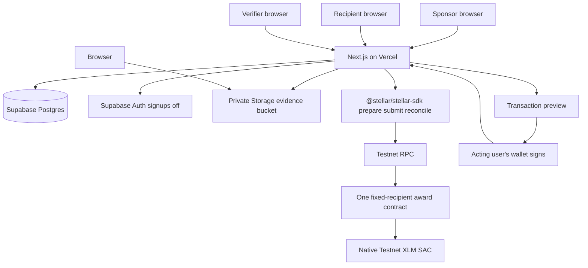

# ProofPay architecture guide

Status: **accepted runtime direction as of 17 November 2026** via [ADR-0001](decisions/0001-nextjs-supabase-runtime.md). Product rules and the Soroban ABI remain owned by the system plan. The Django app remains in-repo as a behaviour oracle until cutover.

Detailed rebuild phases: [implementation/NEXTJS_SUPABASE_REBUILD_PLAN.md](implementation/NEXTJS_SUPABASE_REBUILD_PLAN.md).

## Components and responsibility

The Next.js server decides who can see private records and prepares an allowed transaction. The contract enforces who can change payment state and where funds go. The wallet holds the user's key. The administrator has no payment override.

Confirmed contract state controls money. Never show a successful payout merely because an off-chain review or DB write succeeded.

## Money states

Unchanged from the system plan: Created → Funded → Submitted → Approved → Paid, with Rejected / Refunded / Cancelled and hold / replace-verifier rules as specified there.

## Local vs hosted

| Mode | Stack |
|---|---|
| Local | `web/` Next.js + `npx supabase start` (Docker) + existing `contracts/` |
| Hosted (Phase 9, separate auth) | Vercel Hobby + Supabase Free |

Django templates and the root esbuild wallet bundle are **legacy oracle surfaces**, not the target runtime.
