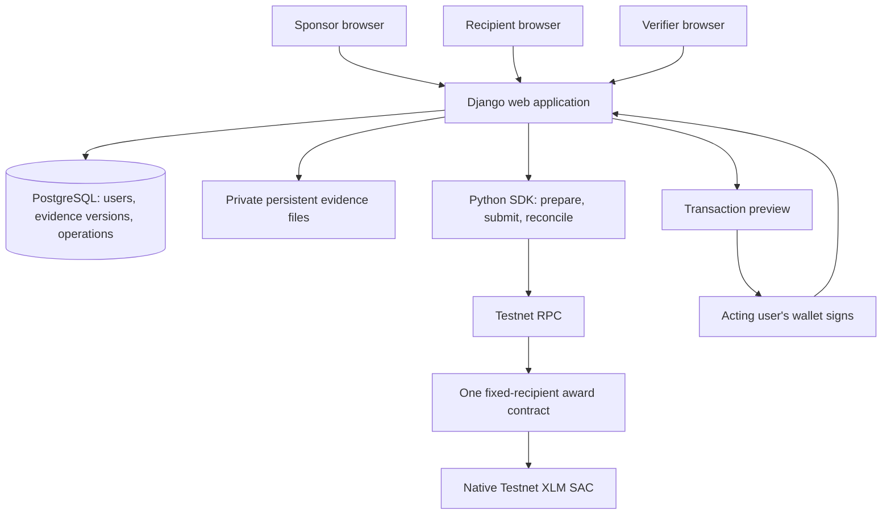
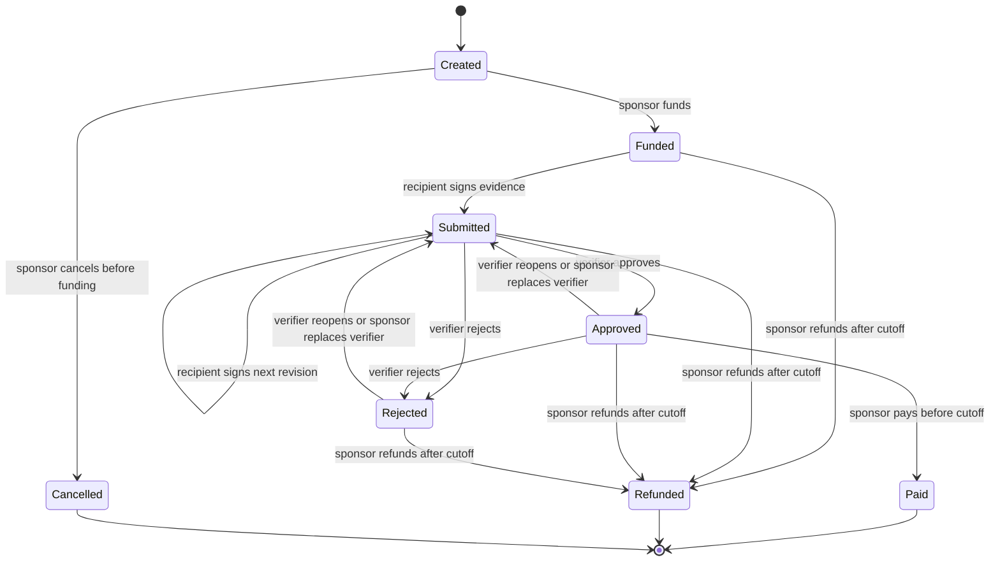

# ProofPay architecture guide

Status: proposed design; no system is deployed. Detailed rules and ABI live in the [system plan](../ProofPay_System_and_Implementation_Plan.md). This guide explains the same design visually.

## Components and responsibility



The app decides who can see private records and prepares an allowed transaction. The contract enforces who can change payment state and where funds go. RPC carries queries and transactions; it is not a separate ProofPay authority. The wallet holds the user's key. The app administrator has no payment override.

The database stores private evidence and rebuildable chain snapshots. Confirmed contract state controls money. Never show a successful payout merely because an off-chain review or DB write succeeded. Source records and photographs stay private; only a randomized evidence commitment is public. Wallet relationships and amounts remain public.

## End-to-end interaction

```mermaid
sequenceDiagram
  participant U as Acting user
  participant A as Web app
  participant W as User wallet
  participant N as Stellar Testnet
  U->>A: Request allowed action
  A->>N: Read current state and simulate transaction
  A->>A: Save intended body, version and operation ID
  A-->>U: Show terms, destination, fee and signing request
  U->>W: Approve exact action
  W-->>A: Signed transaction
  A->>A: Verify body/signature and save hash
  A->>N: Submit saved envelope
  alt Confirmed success and expected state
    N-->>A: Result and ledger state
    A-->>U: Confirmed status and transaction reference
  else Outcome not confirmed
    A-->>U: Unknown outcome; checking network
    A->>N: Reconcile same hash and contract
  end
```

Each person performs their own action: sponsor deploys/funds; recipient submits a digest; verifier approves the exact current revision; sponsor pays. These are separate transactions with separate signatures. Uploading evidence alone does not submit a signed claim.

## Money states



This overview omits per-action guards for readability. The system plan's transition table governs: submit through the claim cutoff, approve/reject/reopen/rotate through the review cutoff, pay through the payout cutoff; refund strictly after it. Holds block approval/payment but do not block expiry refund. Every business mutation checks expected version. `extend_lifetime` maintains storage TTL without changing business version or payment state.

## Screen map

| Screen | Main content | Decision the user makes |
|---|---|---|
| Sponsor dashboard | Program counts, unpaid/approved/refundable awards | Which award needs attention |
| Recipient award | Terms, exact destination, deadlines, evidence versions | Submit the correct completion evidence |
| Verifier queue/detail | Current revision, private files, source-check checklist | Approve, reject, reopen, request changes, or hold |
| Review/sign panel | Action, amount, account, network, recipient, fee | Approve this specific transaction |
| Award timeline/audit | Requested vs confirmed actions and unresolved outcomes | Understand what has actually happened |

Always show “Testnet XLM — no real monetary value.” Reading an authorized page needs no wallet connection. Empty, loading, error, denied, offline, stale, unknown, and confirmed states need readable text and keyboard-accessible controls.

## Failure boundaries

- RPC down: evidence/workflow records remain private; money actions wait and existing submissions stay unresolved.
- Wallet decline: preserve entered data; no payment-success message.
- Two tabs or workers: idempotency and expected-version guards prevent conflicting updates; contract prevents duplicate payout.
- Verifier compromise: sponsor rotates verifier; prior approval loses validity; old evidence access ends only on confirmed rotation.
- Missing/archived/reset chain data: investigate or restore; never silently recreate an award or infer a refund.
- Lost sponsor key: no administrator recovery in this MVP. A technical prototype cannot promise institutional key recovery.
