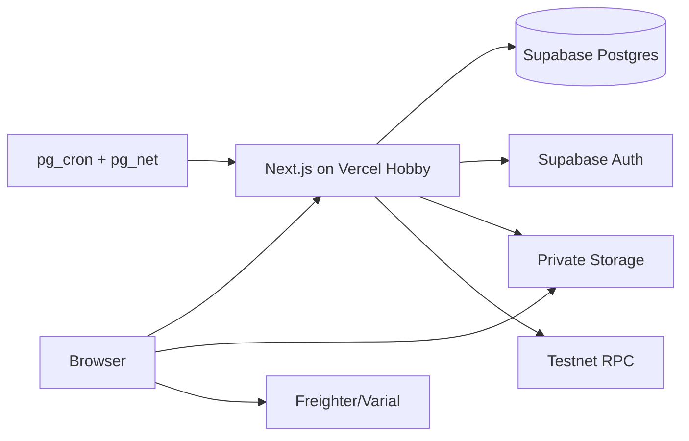

# ProofPay Next.js + Supabase rebuild plan

**Status:** Phase 0 complete — documentation only. No application code, cloud resources, or deploy authorized by this document.  
**Date:** 17 November 2026  
**Branch / worktree:** `implementation/nextjs-supabase` at `C:\Users\R O G - S T R I X\Desktop\Proofpay-next`  
**Base:** `origin/dev` `b5c9c3882b21b4b0014d7f21c91dbb2ba0d5ae6f` (includes UI polish through `c4c724c` plus later docs-only commits)  
**ADR:** [0001-nextjs-supabase-runtime.md](../decisions/0001-nextjs-supabase-runtime.md)

This plan is derived from the four authority documents and does not override them. Product scope, contract ABI, and A1–A10 remain owned by those sources. Architecture runtime ownership moves to the ADR above.

---

## 1. Dated inventory

### Observed facts

| Fact | Evidence |
|---|---|
| Real app is Django + PostgreSQL + Soroban award contract + Freighter signing bundle | Worktree checkout; `config/urls.py`, `proofpay/`, `contracts/award/` |
| Versions | Django 5.2.19, psycopg 3.3.9, stellar-sdk 17.0.1, Python 3.13, soroban-sdk =28.0.0, `@stellar/freighter-api` 6.0.1, esbuild 0.28.2, TypeScript 7.0.2 |
| Local DB | Docker Postgres 17 (compose in repo); not used by the target free-host runtime |
| Contract | `AWARD_AMOUNT = 200_000_000`; TTL threshold 120960 / extend-to 1000000; entry points listed in §3 |
| Chain ops | `ACTIVE` = BUILDING, PREPARED, SIGNED, SUBMITTED, UNKNOWN; `TERMINAL` = CONFIRMED_SUCCESS, CONFIRMED_FAILED, ABANDONED, STALE |
| Roles per action | DEPLOY/FUND/CANCEL/PAY/REFUND/REPLACE_VERIFIER → SPONSOR; SUBMIT → RECIPIENT; APPROVE/REJECT/REOPEN → VERIFIER; SET_HOLD → SPONSOR\|VERIFIER; EXTEND_TTL → all three |
| PARAMS | SUBMIT:`evidence_id`; SET_HOLD:`held`; REPLACE_VERIFIER:`new_verifier_member_id` |
| Evidence | Max 3 files × 5 MiB; PDF (`%PDF-`), JPEG, PNG magic; private storage |
| Auth | No public signup; staff provision; login throttle 5 / 15 min HMAC(username+IP); doors do not grant roles |
| Submission gate | `STELLAR_ALLOW_SUBMISSION` defaults off |
| Baseline tests | 72 Django, 28 contract, 3 wallet-boundary, 4 Python Playwright (oracle until Phase 10) |
| Production data | None. Synthetic seed only. No migration of live awards. |
| Sibling worktrees | `Proofpay-ui` (`implementation/ui-polish`, leave alone); Codex `dev` worktree; Desktop `Proofpay` docs+`ui-mock/` |

### Backend gaps vs system plan (record; build only where a phase says so)

- Missing `/programs/<uuid>/create-award/` route (model helper `create_award` exists).
- No `AuditEvent` / `DisputeRequest` models; disputes are `ReviewAction` with action `DISPUTE`.
- No health endpoint; first-login password change not enforced.
- No `scripts/setup_testnet` / `scripts/deploy_demo`; no CI workflow.

### Files actually inspected for this plan

`AGENTS.md`, `README.md`, `docs/ENGINEERING_STANDARD.md`, `docs/ARCHITECTURE.md`, `docs/HTTP_INTERFACES.md`, `docs/VERIFICATION.md`, `docs/OPERATIONS.md`, `docs/DECISIONS.md`, `docs/OPENSPEC.md`, `docs/templates/ADR.md`, `docs/design/UI_REDESIGN_PROMPT.md`, `ProofPay_Product_and_Scope.md`, `ProofPay_Repository_Validation.md`, `ProofPay_System_and_Implementation_Plan.md`, `ProofPay_Agent_Handoff_and_InstaAward_Checklist.md`, `config/urls.py`, `proofpay/{models,chain,chain_views,presentation,permissions,evidence,reviews,recovery,forms,login_view,views,exports}.py`, `proofpay/management/commands/{seed_demo,reconcile_chain,refresh_awards,purge_evidence}.py`, `contracts/award/src/lib.rs`, `static_src/wallet.ts`, `static_src/wallet_validation.ts`, `pyproject.toml`, `package.json`, `contracts/award/Cargo.toml`. Design inputs from Desktop `Proofpay/ui-mock/{README,COVERAGE,VERIFICATION,SCREEN_INVENTORY,polish.css}` and `docs/design/UI_INSPO_PROOFPAY.jpg`.

### Conflicts recorded

| Conflict | Resolution in this rebuild |
|---|---|
| System plan §1 “do not introduce a Node API”; Django architecture | ADR-0001: Next.js is the runtime (UI + server). Product/contract rules unchanged. |
| `docs/DECISIONS.md` “Server-rendered pages with small signing bundle”; “Original small Django application” | Superseded by ADR-0001 for runtime. Immutable-award / evidence / role decisions stay. |
| Engineering standard “use native Django auth, sessions, forms, CSRF, ORM” | Superseded for runtime by ADR-0001; equivalent controls: Supabase Auth (signups off), Origin checks, zod-strict bodies, SQL constraints + transactions. |
| Brand Direction A (pine/ochre/paper) vs handoff forest/ivory/coral | Follow handoff + `ui-mock/polish.css` tokens. |
| Chain `{"error":"CODE"}` vs HTTP_INTERFACES envelope | Chain handlers keep CODE shape; other JSON uses documented envelope. |
| Mock admin support cases / invites / workshop guide | Out of scope; invite → create-award; settings → password/account. |

---

## 2. Route and role parity matrix

| Current / required | Role(s) | Django source | Next destination | Must stay equivalent | A1–A10 | Tests |
|---|---|---|---|---|---|---|
| `/` entry | Shared | (Django had shared `/login/`) | `/` role doors (no shared login form) | Choose workspace only; no credentials on entry | A10 | Phase 3 |
| `/login/` | Shared | `RoleLoginView` | redirect → `/` | **No shared login form** (owner decision 17 Nov 2026) | A10 | Phase 3 |
| `/login/<door>/` | Shared | `RoleLoginView` | `/login/[door]` | Door explains job; never grants role; credentials here only | A10 | Phase 3 |
| `/logout/` | Shared | `LogoutView` | `POST /api/v1/session/logout` | Clears session | A10 | Phase 3 |
| `/password-change/` | Shared | `PasswordChangeView` + form | `/password-change` | Current password required; labels without trailing colon | A10 | Phase 3 |
| `/programs/` | S/V/R | `program_list` | `/programs` | Memberships, decorated awards, attention order, home copy | A1,A10 | Phase 4 |
| `/programs/<uuid>/` | S/V/R | `program_detail` | `/programs/[id]` | Confirmed-snapshot counts; 404 outsiders | A1,A7 | Phase 4 |
| `/programs/<uuid>/export/` | S/V | `program_export` | download via route handler | CSV scope; no evidence bytes | A3,A10 | Phase 5 |
| `/programs/<uuid>/create-award/` (gap) | Sponsor | `create_award()` only | `/programs/[id]/create-award` + API | Distinct users/wallets; fixed amount; program deadlines | A1 | Phase 8 |
| `/awards/<uuid>/` | S/V/R | `award_detail` / `award_context` | `/awards/[id]` | Role section order; presentation copy; chain choices | A2–A8 | Phase 5–7 |
| `/awards/<uuid>/audit/` | S/V/R | `award_audit` | `/awards/[id]/audit` | Public ops only; no private evidence | A8,A9 | Phase 5 |
| `/awards/<uuid>/evidence/` | Recipient | `evidence_upload` / `store_evidence` | begin + finalize APIs | 3×5 MiB; magic bytes; stale → 409 | A3,A6 | Phase 5 |
| `/evidence/<uuid>/download/` | Award parties | `evidence_download` | signed URL after check | Attachment; nosniff; no-store; outsider 404 | A3 | Phase 5 |
| `/awards/<uuid>/review/` | Verifier | `review_request` | same via API | Source check required for approve path | A3,A5,A6 | Phase 5 |
| `/awards/<uuid>/request-changes/` | Verifier | action REQUEST_CHANGES | same | Off-chain only | A3,A6 | Phase 5 |
| `/awards/<uuid>/disputes/` | Recipient | action DISPUTE | same | Off-chain ReviewAction | A7 | Phase 5 |
| `/awards/<uuid>/prepare/<action>/` | Role per ROLES | `chain_views.prepare` | `POST .../prepare/[action]` | Idempotency; expected_version; preview | A2,A5,A8 | Phase 6 |
| `/awards/<uuid>/prepare/payout/` | Sponsor | prepare PAY alias | same as prepare/PAY | Identical to PAY | A4 | Phase 6 |
| `/operations/<uuid>/` | Actor | `chain_views.status` | `GET /operations/[id]` | Poll; never invent success | A8,A9 | Phase 6–7 |
| `/operations/<uuid>/submit/` | Actor | `submit` | `POST .../submit` | validate_signed then submit; gate | A4,A5,A8 | Phase 6–7 |
| `/operations/<uuid>/abandon/` | Actor | `abandon` | `POST .../abandon` | Unsigned PREPARED only | A8 | Phase 6–7 |
| `/wallet-check/` | Shared | `wallet_check` | `/wallet-check` | Connection only; no prepare | A5 | Phase 7 |
| 403 / 404 | Shared | handlers | `forbidden` / `not-found` | Unrelated → 404; forbidden known → 403 | A3,A5 | Phase 3 |
| `/admin/` Django | Staff | Django admin | keep out of product UI | Staff provisioning via Next admin subset | A1 | Phase 8 |
| Admin members / programs | Staff | gap vs mock | `/admin/members`, `/admin/programs/[id]` | No evidence; no fund actions | A1,A3,A5 | Phase 8 |

### Operation states and UI conditions

| State / condition | Equivalent behaviour | Phase |
|---|---|---|
| PREPARED, SIGNED, SUBMITTED, UNKNOWN, CONFIRMED_SUCCESS, CONFIRMED_FAILED, ABANDONED, STALE | Same transitions as `chain.py` / `test_chain.py` | 6–7 |
| Wallet unavailable / wrong account / wrong network / declined | Client messages; no submit | 7 |
| RPC offline / stale version | Server codes; UI shows not confirmed | 6–7 |
| UNKNOWN after timeout | “Outcome not confirmed”; never re-prepare; reconcile only | 6–7 |

---

## 3. Parity spec (Python → TypeScript)

| Python | TypeScript destination | Invariants | Locks / transactions | Oracle pin |
|---|---|---|---|---|
| `permissions.visible_awards` / `require_award_role` | `web/lib/permissions.ts` | Scope before return; outsider 404 | Read | Ported permission tests |
| `presentation.status_lines|next_step|tracker_steps|user_acts_now|home_copy|sort_awards_for_home` | `web/lib/presentation.ts` | Copy only from module; unconfirmed ≠ Paid | Read | Golden fixtures × state×role×hold |
| `forms.ProvisionedAuthenticationForm` throttle | `web/lib/auth/throttle.ts` + login route | 5/15 min; exact messages | Upsert `login_attempt` | Fixture sequences |
| `evidence.store_evidence` + magic | begin/finalize + `web/lib/evidence.ts` | 3×5 MiB; PDF/JPEG/PNG; delete orphans | Tx + Storage | Magic/size fixtures |
| `reviews.record_review_request` | `web/lib/reviews.ts` | Source check for approve | Tx | Edges tests |
| `recovery.*` | `web/lib/chain/recovery.ts` | Expiry refund rules unchanged | `FOR UPDATE` | Recovery cases |
| `chain.prepare_action` | `web/lib/chain/prepare.ts` | ROLES/PARAMS; no browser-built tx | Award + op lock | Unsigned XDR golden |
| `chain.validate_signed` | `web/lib/chain/validate.ts` | Signer, network, body match | — | Accept/reject fixtures |
| `chain.submit_signed` | `web/lib/chain/submit.ts` | Gate off by default; idempotent | Op lock | Gate + duplicate |
| `chain.reconcile` | `web/lib/chain/reconcile.ts` | UNKNOWN never updates award until confirmed | Op + award lock | Timeout/success/fail |
| `chain.RPCGateway` | `web/lib/chain/rpc.ts` + FakeRpc | Passphrase + WASM hash checks | — | Fake in unit tests |
| `chain_views.*` | `app/api/...` route handlers | Same `{"error":"CODE"}` | Via lib | API tests |
| `models.create_award` | `web/lib/awards/create.ts` | Distinct users/wallets; 200_000_000 | Tx | Validation cases |
| `exports` / purge / refresh / seed | matching `web/lib` + scripts | No evidence in export; public G-addresses only | As needed | Seed + export tests |
| `wallet.ts` / `wallet_validation.ts` | `web/lib/wallet/*` | Idempotency-Key; preview; poll; UNKNOWN | Client | Mock Freighter + e2e |

Contract methods (frozen; no TS rewrite of Rust): `__constructor`, `get_state`, `fund`, `cancel`, `submit`, `approve`, `reject`, `reopen`, `set_hold`, `replace_verifier`, `pay`, `refund`, `extend_lifetime`.

---

## 4. Behaviour preservation matrix

| Concern | Django today | Target equivalent |
|---|---|---|
| Sessions | Cookie session + CSRF httponly | Supabase Auth cookies via `@supabase/ssr`; mutating handlers require matching `Origin` |
| 404 vs 403 | Unrelated 404; forbidden known 403 | Same |
| Login throttle | HMAC username+IP, 5/15 min | Same digest scheme with `AUTH_THROTTLE_SECRET`; IP from Vercel forwarded headers only when behind Vercel |
| Evidence limits | 3×5 MiB; magic; attachment nosniff no-store | Same; upload via signed URL (Vercel 4.5 MB body limit); finalize re-validates |
| Immutable terms | Model + contract | SQL check + contract unchanged |
| expected_version / idempotency | Unique actor+key; version check | Same constraints and lock order |
| Signed tx validation | Body/signer/network | Ported `validate_signed` |
| Reconciliation | Management command + status | `pg_cron`→internal route + on-demand Refresh; Hobby daily cron backstop |
| Retention / purge | `purge_evidence` | Ported job |
| Exports | Scoped CSV | Ported stream |
| Secrets | No Stellar secret server-side | Same; service role + DB URL + throttle + cron secrets only |

---

## 5. Schema map

| Django | SQL / Storage | Constraints / RLS |
|---|---|---|
| `auth.User` (+ staff) | Supabase `auth.users` + `app_user` profile (`is_staff`, username) | Signups disabled; service-role create only |
| `Program` | `program` | Deadline checks as today |
| `ProgramMember` | `program_member` | Unique (program,user), (program,wallet); role enum |
| `Award` | `award` | Unique recipient/program; distinct members; `base_units=200000000` |
| `LoginAttempt` | `login_attempt` | Unique digest |
| `EvidenceVersion` / `EvidenceFile` | tables + Storage object path | Unique revision; private bucket `evidence` |
| `ReviewAction` | `review_action` | Actions REQUEST_REVIEW, REQUEST_CHANGES, DISPUTE, … |
| `ChainOperation` / `ChainObservation` | tables | Idempotency unique; unresolved signer unique |

**RLS:** enabled on every app table; **no policies** for `anon` or `authenticated` (deny all). Server uses DB role / service connection. pgTAP proves zero row access for those roles.

---

## 6. Stack table

| Item | Responsibility | Licence / pricing basis | Version policy | Decision |
|---|---|---|---|---|
| Next.js + React + TS | UI + route handlers | OSS; Vercel Hobby personal/non-commercial (POC/MVP confirmed) | Pin at Phase 1 via `npm view` | Accepted |
| Supabase Free | Postgres, Auth, Storage, pg_cron/pg_net | Free: 500 MB DB, 1 GB storage, pause after 7 idle days, no backups, 2 active projects | CLI as devDep | Accepted |
| `postgres` (js) | Transactional SQL + `FOR UPDATE` via pooler | OSS | Pin Phase 1 | Accepted |
| `@supabase/supabase-js`, `@supabase/ssr` | Auth + Storage signed URLs | OSS | Pin Phase 1 | Accepted |
| `@stellar/stellar-sdk` | Server chain port | OSS | Pin Phase 1; match supported Freighter era | Accepted |
| `@stellar/freighter-api` | Browser signing | Already 6.0.1 | Keep 6.0.1 | Accepted |
| `zod` | Strict request bodies | OSS | Pin Phase 1 | Accepted |
| Vitest, Testing Library, Playwright | Tests | OSS | Pin Phase 1 | Accepted |
| Soroban contract | On-chain rules | Existing | Frozen `soroban-sdk =28.0.0` | Frozen |
| Django oracle | Golden behaviour until Phase 10 | Existing | Untouched until cutover | Accepted |

No Tailwind/UI kit/ORM/file-type package. Magic bytes ported from `evidence.py`.

---

## 7. Data and cutover

- No production data exists. Local synthetic seed is re-created, not migrated.
- In-flight operations: none in production; local UNKNOWN ops must not be reinterpreted as new awards.
- Cutover (Phase 10): tag `django-final`, remove Django runtime packages/templates, keep `contracts/` and oracle fixtures. Rollback = check out `django-final`.

---

## 8. Threat changes

| Threat | Mitigation |
|---|---|
| Signed upload/download URLs are bearer tokens | Short TTL; exact path; finalize validates or deletes; 60 s download |
| Orphaned Storage objects | Sweep with reconcile; finalize failure deletes |
| Service-role / DB URL leak | Server-only env; never `NEXT_PUBLIC_`; bundle scan in Phase 9 |
| Pooler prepared statements | `prepare: false` on transaction pooler |
| Throttle IP collapse | Use Vercel client IP headers only when documented trusted; record if unknown |
| CSRF replacement | Origin check on mutations + Supabase cookie session |
| Free-tier pause / no backups | Document resume; `supabase db dump` before risky changes |
| Cron abuse | `Authorization: Bearer CRON_SECRET` |
| Headers | CSP, `frame-ancestors`, nosniff, `Cache-Control: private, no-store` on private responses |
| Client Stellar secrets | Never; wallets sign in browser |

---

## 9. A1–A10 coverage by phase

| Criterion | Phases | Notes |
|---|---|---|
| A1 | 2, 4, 8 | Program, 10 recipients, fixed terms, admin provision |
| A2 | 6, 7, 11 | Fund + balance checks (11 Testnet) |
| A3 | 5 | Private evidence + outsider denial |
| A4 | 6, 7, 11 | Approve + pay once |
| A5 | 6, 7, 11 | Wrong signer, hold, expiry, duplicate pay fail |
| A6 | 5, 6, 8 | Revisions + verifier replace |
| A7 | 6, 11 | Expiry refund including held |
| A8 | 6, 7 | UNKNOWN + no double pay |
| A9 | 6 | Reconstruct from ops + contract reads |
| A10 | 1–10 | Testnet labels; reproducible setup |

All A1–A10 remain **NOT RUN** against live Testnet until Phase 11 is authorized.

---

## 10. Decision log

| Item | Status |
|---|---|
| Vercel Hobby for personal POC/MVP | **Settled** 17 Nov 2026 |
| No shared login form; entry is role doors only | **Settled** 17 Nov 2026 |
| Freighter/Varial ready in Brave | **Settled** |
| Supabase free slot available (1 active project already) | **Settled** |
| Vercel GitHub app access to `storms23/ProofPay` | **Deferred** to Phase 9 |
| First-login password enforcement | **Pending** (needs migration/ADR if yes) |
| Create-award terms form fields | **Pending** (immutable review of program defaults) |
| Reconciliation interval | **Default 5 min** via pg_cron; change only with evidence |
| Username → internal email scheme | **Pending** (e.g. `username@users.proofpay.local`); must be non-deliverable |

---

## 11. Phased sequence

| Phase | Goal | Exit |
|---|---|---|
| **0** | This document + ADR | Links/coverage OK; **stop for review** |
| **1** | Oracle fixtures + `web/` shell + local Supabase | lint/typecheck/test/build; cargo 28; django 72; frozen diff empty |
| **2** | Schema, RLS deny-all, private bucket, db access layer, seed | pgTAP green |
| **3** | Auth, throttle, doors, password, 403/404 | Playwright login per role |
| **4** | Permissions + presentation parity; role homes | Golden presentation + scope tests |
| **5** | Award, evidence begin/finalize, reviews, audit, export | Upload/download privacy tests |
| **6** | Chain TS port + reconcile schedule | XDR/state parity with oracle |
| **7** | Wallet client port | Mock Freighter + intercepted e2e |
| **8** | Create-award + staff admin | Non-staff 403; no support cases |
| **9** | Hosted preview (**deploy auth required**) | Preview smoke; submission off |
| **10** | Cutover; remove Django runtime | Parity green; tag `django-final` |
| **11** | Testnet rehearsal (**submission auth required**) | Checklist only |

### Frozen set (every phase)

`contracts/` byte-identical; Django oracle read-only until Phase 10.  
`git diff --stat origin/dev -- contracts proofpay config static_src templates` must show no unintended edits during Phases 1–9.

### Gate commands (every phase)

1. `npm --prefix web run lint && typecheck && test && build` (from Phase 1)  
2. `npx supabase test db` (from Phase 2)  
3. `npx playwright test` in `web/` (from Phase 3)  
4. `web/tests/parity/` (from Phase 4)  
5. `cargo test --manifest-path contracts/award/Cargo.toml --locked`  
6. `uv run python manage.py test proofpay.tests --noinput` (≥72 until Phase 10)  
7. Frozen-set + no secrets in diff  
8. Record NOT RUN with reason

### Anti-drift

Port, don’t redesign. Name the Python function each TS module ports. Status copy only from presentation port. Browser never builds transactions. No commit/push/cloud/deploy without instruction. Accessible names and `data-*` hooks preserved (see ADR / prior UI polish). Testnet banner on every screen.

### Topology

### Connections (17 Nov 2026)

| Service | Status |
|---|---|
| GitHub `storms23/ProofPay` | Connected |
| Supabase org; 1 free active slot | Connected |
| Vercel CLI `storms23` | Logged in; GitHub app deferred |
| Docker | Installed |
| Supabase CLI | Via `npx` in Phase 1 |
| Brave Freighter/Varial | Ready |
| Email / custom domain | Not required |

---

## 12. Phase 0 validation checklist

- [x] Worktree created; base SHA recorded  
- [x] Inventory, matrices, parity, schema, stack, threats, A1–A10, decisions, phases present  
- [x] ADR-0001 written  
- [x] Contract methods listed  
- [x] All current `config/urls.py` routes mapped  
- [ ] User review of this plan before Phase 1  

**NOT RUN:** any application scaffold, Supabase cloud project, Vercel deploy, Testnet submission, A1–A10 live evidence.
