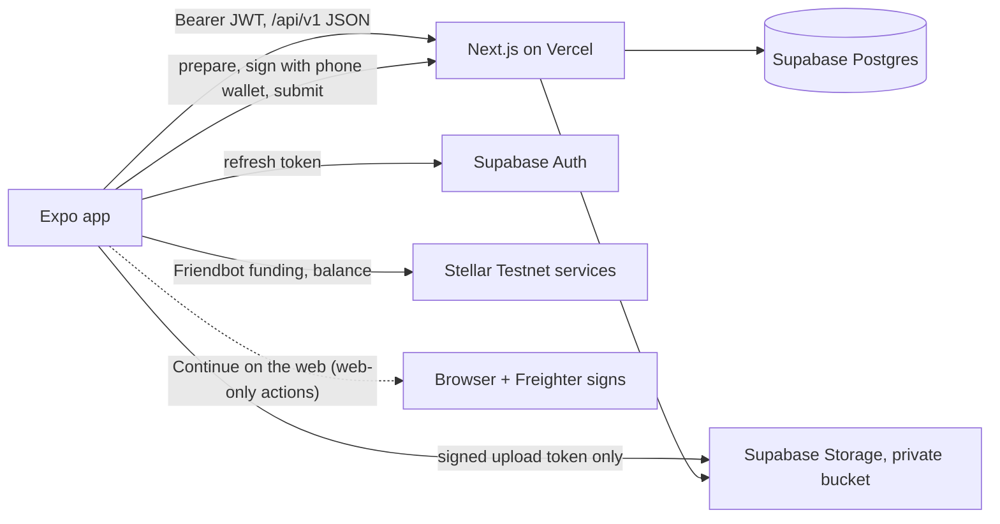

# Fundora mobile app: plan and change proposal

- Status / author / date: **APPROVED 19 November 2026** ([ADR-0002](../decisions/0002-expo-mobile-client.md)). Implementation in progress.
- Agent execution guide: [AGENT_ROADMAP.md](AGENT_ROADMAP.md).

Nothing in this document overrides the four authoritative ProofPay handoff files. Where this plan touches funds, signers, privacy, or deployment scope, the [engineering standard](../ENGINEERING_STANDARD.md) requires an explicit user decision before that behavior is built.

## 1. Change proposal (per [templates/CHANGE.md](../templates/CHANGE.md))

| Field | Content |
|---|---|
| User request and authorized scope | Plan a React Native (Expo) mobile version of Fundora with good features and a clean structure, including **camera upload**: a recipient takes a photo or picks a file straight from the phone. This request authorizes the plan. It does not authorize building, EAS accounts, store publishing, or push services. |
| Problem / expected result | Recipients collect evidence in the field on their phones. Today they must move photos to a computer and use the web app. Expected result: a recipient signs in on a phone, opens their award, captures or picks evidence, and creates a draft evidence revision through the same server rules the web app uses. |
| Source requirements | [Product and scope](../../ProofPay_Product_and_Scope.md) §3 roles, §4 MVP, §5 privacy; A3 (evidence access), A8 (unknown shown as unknown), A10 (visibly Testnet). |
| Current behavior and evidence | §4 of product scope lists "mobile apps" as **excluded**. `web/lib/http.ts` `requireSameOrigin` rejects mutating requests that have no `Origin`, and React Native `fetch` sends none. `web/lib/supabase/server.ts` reads the session only from cookies. Award data is rendered by server components; the only JSON reads are session, operation status, open operations, evidence download, and export. |
| Proposed change | (a) Small bearer-token additions to `web/` (§5). (b) A new Expo app in `mobile/` that reuses the existing `/api/v1` endpoints (§3–§4, §6). |
| Effects | **Roles:** unchanged; every check stays server-side. **Funds:** Testnet only. Since ADR-0003 the app holds a Testnet wallet key in secure storage and signs SUBMIT, APPROVE and PAY (§7). **Privacy:** camera photos carry GPS EXIF, so the app strips it before upload (§4.3). Evidence is cached only in app-private storage. **Dependencies:** Expo SDK and the packages in §8. **Migrations:** none. **Operations:** EAS builds need an Expo account (separate authorization). |
| Alternatives | *PWA / responsive web:* cheapest, but camera capture through the browser gives no HEIC→JPEG control and no EXIF stripping guarantee, and the user asked for React Native. *Bare React Native without Expo:* more native setup and no OTA updates for no gain. *Embedded wallet inside the app:* first rejected; later adopted for Testnet only by user decision (ADR-0003). |
| Required tests | Bearer auth and origin-bypass tests in `web/` (TDD: these are a trust boundary). Mobile unit tests for amount formatting, file normalization, and the upload state machine. Maestro E2E for sign-in → camera upload → draft visible. |
| Rollback | The web additions are additive. Turning off `MOBILE_BEARER_AUTH=0` disables the bearer path. Removing `mobile/` has no effect on web. |
| **User decisions needed** | 1. Approve lifting the "mobile apps" exclusion for a **Testnet-only, recipient-first** client. 2. Approve the bearer-token path in `web/` (§5). 3. Confirm app identifiers (`com.fundora.app` is a placeholder and cannot change after a store release). 4. Separately, later: Expo/EAS account, internal distribution, any store submission, push notifications. |
| Outcome | Not run — planning document only. |

## 2. Product shape: what the mobile app is for

The phone is where evidence is created. The desk is where money moves. v1 is therefore **recipient-first**, gives verifiers useful read and triage access, and gives sponsors a read-only view. Every chain signature stays on the web (Freighter) until the signing spike in §7 passes.

### 2.1 Features by role

| # | Feature | Recipient | Verifier | Sponsor | v1? |
|---|---|---|---|---|---|
| F1 | Sign in with a provisioned username and password, forced password change, sign out | ✓ | ✓ | ✓ | v1 |
| F2 | Biometric / device-passcode relock after 5 min in background (`expo-local-authentication`) | ✓ | ✓ | ✓ | v1 |
| F3 | Permanent "Testnet XLM — no real monetary value" banner on every screen | ✓ | ✓ | ✓ | v1 |
| F4 | **My awards**: list with status, amount, next deadline; pull-to-refresh | ✓ | | | v1 |
| F5 | **Award detail**: terms, verifier, deadlines (labeled timezone), recovery rules, recipient wallet, status timeline, confirmed transaction references | ✓ | ✓ | ✓ | v1 |
| F6 | **Camera upload**: take a photo, pick photos from the library, or pick a PDF; preview, reorder, remove; explanation + source reference; upload as a draft revision (§4) | ✓ | | | v1 |
| F7 | Evidence history with revision numbers and "draft vs submitted" state | ✓ | ✓ | ✓ | v1 |
| F8 | In-app evidence viewer (image zoom, PDF view) via the authenticated download route; nothing saved to the photo library | ✓ | ✓ | ✓ | v1 |
| F9 | **Review queue**: awards waiting on this verifier, sorted by review deadline | | ✓ | | v1 |
| F10 | Request changes (off-chain review action with rationale and source-check method) | | ✓ | | v1 |
| F11 | Recipient dispute request (off-chain; never a contract hold) | ✓ | | | v1 |
| F12 | Program overview: awards by status, totals in Testnet XLM | | | ✓ | v1 |
| F13 | Operation status screen: PREPARED / SUBMITTED / UNKNOWN / CONFIRMED_*, honest wording (A8) | ✓ | ✓ | ✓ | v1 |
| F14 | **"Continue on the web"**: opens the exact award page in the system browser for web-only actions (deploy, fund, reject, holds, refund) or when the phone wallet does not match | ✓ | ✓ | ✓ | v1 |
| F15 | Local deadline reminders (claim / review deadline minus 24 h), scheduled on the device; no server or push token | ✓ | ✓ | | v1 |
| F16 | Deep links `fundora://awards/<id>`, also used by reminders | ✓ | ✓ | ✓ | v1 |
| F17 | Hide content in the app-switcher snapshot on evidence and detail screens | ✓ | ✓ | ✓ | v1 |
| F18 | Dark mode, Dynamic Type / font scaling, VoiceOver and TalkBack labels, 44 pt touch targets | ✓ | ✓ | ✓ | v1 |
| F19 | Built-in Testnet wallet: create, fund with Friendbot, sign with fingerprint or face (ADR-0003) | ✓ | ✓ | ✓ | v1 |
| F20 | Server push on status change | ✓ | ✓ | ✓ | **Later**: separate authorization (external service, device tokens) |
| F21 | Approve and pay from the phone; reject, refund and holds stay on the web | | ✓ | ✓ | v1 (approve, pay) |

Deliberately excluded, as in the web MVP: AI checks, "verified" or "fraud-proof" claims about photos, public signup, Mainnet, real money, wallets other than the Testnet-only phone wallet (ADR-0003), exports on the phone, and admin screens.

### 2.2 Core journeys

1. **Recipient in the field:** reminder → deep link to award → "Add evidence" → camera → photo preview → explanation + source reference → Upload → draft revision shown → "Sign submission" with the phone wallet, or "Continue on the web" if the award uses another wallet.
2. **Verifier triage:** Review tab → award → view evidence full-screen → compare with the organizer's source record → Request changes with rationale, or Approve (note with source check, then sign with the phone wallet). Rejecting stays on the web.
3. **Sponsor check-in:** Programs tab → status counts → award detail → confirmed transaction reference.

## 3. Architecture



- **One source of truth:** the mobile app has no business rules of its own. It calls the same `/api/v1` handlers as the web app, so `requireAwardRole`, revision checks, file validation, and the chain pipeline are reused.
- **Client never supplies** a destination, asset, amount, contract ID, or fee (HTTP interfaces, common rules). The app sends only IDs, text fields, and file bytes.
- **Client-side validation is for UX only.** Server finalize stays authoritative for file signatures and sizes.
- Response shapes are parsed with `zod` in the app. An unexpected shape becomes a safe error screen, never a guess.

## 4. Camera upload (F6) in detail

### 4.1 Sources

| Source | API | Notes |
|---|---|---|
| Take photo | `expo-image-picker` `launchCameraAsync({ mediaTypes: ['images'], quality: 1, exif: false })` | Never call `MediaLibrary.saveToLibraryAsync`; evidence must not land in the shared gallery. |
| Pick photos | `launchImageLibraryAsync({ mediaTypes: ['images'], allowsMultipleSelection: true, selectionLimit: 3 - current })` | Uses the system photo picker (no full-library permission on Android 13+ or iOS 14+). |
| Pick a PDF | `expo-document-picker` `getDocumentAsync({ type: 'application/pdf', copyToCacheDirectory: true })` | PDF only; other types are refused with the server's own message. |

Permission purpose strings are set through the `expo-image-picker` config plugin in `app.json`, for example: *"Fundora uses the camera to photograph evidence for your award. Photos are uploaded privately and not saved to your gallery."* If permission is denied, show an inline explanation and an "Open Settings" button. The other sources keep working.

### 4.2 Limits (mirroring `web/lib/evidence/validate.ts`)

- Maximum **3 files** per revision and **5 MiB** each; PDF, JPEG or PNG only; extension, MIME type and leading bytes must agree.
- Explanation 1–2,000 characters; source reference 1–512 characters.
- Filenames have no path separators or control characters and are at most 160 characters long.

### 4.3 Normalization pipeline (`src/lib/evidence/prepare-file.ts`)

1. **Images (including HEIC/HEIF):** `expo-image-manipulator` resizes to a 2,048 px longest edge and saves as JPEG at quality 0.8. Re-encoding **drops all EXIF, including GPS location**, which is a privacy requirement (§5 of product scope keeps location data off-chain and minimal).
2. If the result is still over 5 MiB, retry once at quality 0.6, otherwise refuse with a clear message.
3. **PDFs:** no transform; check size and the `%PDF-` header.
4. Check the leading bytes against the declared type (same magic numbers as the server).
5. **Names:** photos become `photo-1.jpg`, `photo-2.jpg`; PDFs keep a sanitized original name. Device or user names never enter filenames.

### 4.4 Upload state machine (`src/lib/evidence/upload.ts`)

```
idle → preparing → beginning → uploading(n/3) → finalizing → done
                      ↓            ↓               ↓
                    failed ←───────┴───────────────┘   (retry keeps the draft)
```

1. `POST /api/v1/awards/{id}/evidence/begin` with explanation, source_ref, `expected_revision`, filenames and content types → signed upload tokens.
2. Upload each file to Storage with its signed token (`uploadToSignedUrl`). The app never sees a storage path it can reuse.
3. `POST /api/v1/awards/{id}/evidence/finalize` → new revision.
4. On failure after begin, call `DELETE …/evidence/begin` so no orphan objects remain, then offer Retry.
5. A `409` stale revision shows "This award changed. Refresh before uploading." The draft is kept.

**No data loss:** normalized files stay in the app's private document directory until finalize succeeds, then they are deleted. All drafts are deleted on sign-out. The screen states: *"Uploaded evidence is a draft until you sign its submission."*

## 5. `web/` changes (implemented 19 Nov 2026)

| Change | Where | Why |
|---|---|---|
| `POST /api/v1/session/login` with `"client": "mobile"`: same throttle and username mapping; an origin-less request returns `access_token`, `refresh_token`, `expires_at` and sets no cookies; a request that sends `Origin` keeps the cookie session; an origin-less request is accepted only in this mode | `web/app/api/v1/session/login/route.ts` | Native login without bypassing the throttle (one route, no copy) |
| `bearerToken(request)`: honored only when `MOBILE_BEARER_AUTH=1`, there is no `Cookie` header, and the header is `Authorization: Bearer …`; `requireSameOrigin` accepts such requests without `Origin` | `web/lib/http.ts` | CSRF needs ambient cookies; a cookie request keeps the strict check |
| `getRequestAuthUser(request)` and `createSupabaseTokenClient()` | `web/lib/supabase/server.ts` | One auth entry point for bearer or cookie |
| Bearer accepted on: session GET, awards list/detail, evidence begin/finalize/cancel/download, review POST, operation status, open operations | those route files | Only what the app calls; prepare/submit/abandon/export/admin/password stay cookie-only |
| `GET /api/v1/awards`, `GET /api/v1/awards/{id}` (adds program terms, `version`, evidence history) | new route files, `myRoles` in `lib/awards/queries.ts` | Award data was only in server components. The review queue and sponsor overview are derived in the app from the list, so they need no endpoints. |
| Kill switch `MOBILE_BEARER_AUTH` (default `0`) | `web/.env.example` | Rollback without a deploy |

The password change stays cookie-only: a first-login account is sent to the web to finish setup. Tests: `web/tests/http.test.ts` (bearer block), `web/tests/mobileLogin.test.ts`, `web/tests/mobileAwardRoutes.test.ts`. Documented in [HTTP_INTERFACES.md](../HTTP_INTERFACES.md#mobile-app-access-19-nov-2026-adr-0002).

## 6. Project structure (`mobile/`, as built)

New project from `create-expo-app` (Expo SDK 58), laid out per the `expo-project-structure` skill. It lives beside `web/` with no workspace tooling; nothing is shared at build time.

```
mobile/
├── app.json            # Fundora, scheme "fundora", com.fundora.app, version 0.1.0, fingerprint runtime, EAS project link
├── eas.json            # preview (internal) / production (autoIncrement) profiles, remote app versions
├── .env.example        # EXPO_PUBLIC_* values (public only)
├── .maestro/           # sign-in.yaml, camera-upload.yaml
├── assets/images/      # icon, adaptive icon, splash, favicon generated from web/public/fundora/mark-f.png
└── src/
    ├── app/                                   # routes only
    │   ├── _layout.tsx                        # theme, QueryClient, SessionProvider, Stack.Protected guards, reminder deep links
    │   ├── sign-in.tsx
    │   └── (app)/
    │       ├── _layout.tsx                    # Stack; evidence and review screens are modals
    │       ├── (tabs)/_layout.tsx             # NativeTabs: Awards · Reviews (verifiers only) · Account
    │       ├── (tabs)/index.tsx               # F4 + F12: your awards, sponsored programs with status counts
    │       ├── (tabs)/reviews.tsx             # F9: waiting for review, other assigned
    │       ├── (tabs)/account.tsx             # programs, web hand-off, sign out, version
    │       ├── awards/[id]/index.tsx          # F5, F7, F8, F13, F14, F15
    │       ├── awards/[id]/evidence/new.tsx   # F6 camera upload
    │       └── awards/[id]/review.tsx         # F10 request changes / F11 dispute (one form, two copies)
    ├── screens/award-card.tsx
    ├── components/ui.tsx                      # Screen + TestnetBanner, Card, Button, Field, Notice, pills
    ├── components/privacy-lock.tsx            # F2 relock + F17 app-switcher cover
    ├── hooks/use-session.tsx, use-awards.ts
    ├── constants/theme.ts                     # light tokens from web/app/tokens.css + dark variant
    └── lib/
        ├── config.ts
        ├── api/client.ts, schemas.ts          # bearer fetch, error parsing, zod response schemas
        ├── auth/session.ts                    # SecureStore tokens, single-flight refresh, revoke
        ├── evidence/rules.ts (+test)          # limits, signatures, EXIF detector, safe names
        ├── evidence/upload.ts (+test)         # begin → signed PUT → finalize, cancel on failure
        ├── evidence/drafts.ts                 # HEIC→JPEG/EXIF strip, private drafts, authenticated preview
        ├── format/amount.ts, status.ts (+tests), date.ts
        └── reminders.ts                       # local notifications
```

Conventions: kebab-case files, styles at the bottom of each file, tests beside the file they test. Shared UI is one small `ui.tsx` built on React Native core components. Moving form controls to `@expo/ui` is an M7 polish item; it was not needed for v1. A separate operations screen and a password-change screen were dropped: the award detail shows pending transactions, and first-login accounts finish setup on the web.

### 6.1 Session storage

Access token, refresh token and expiry are three separate `expo-secure-store` items, each far below the per-item size limit, so no encryption wrapper or AsyncStorage is needed. Refresh calls Supabase's token endpoint directly, one at a time, because refresh tokens rotate. Sign-out revokes the session server-side (best effort), deletes the tokens, every evidence draft and viewed file, and the query cache. The password is never stored.

## 7. Signing on mobile

**Decision (ADR-0003): option D, a built-in Testnet wallet.** Freighter is a browser extension and has no React Native API. The options considered:

| Option | Shape | Check before adopting |
|---|---|---|
| A. Continue on web (kept for web-only actions) | `expo-web-browser` opens `https://<preview>/awards/<id>`; the user signs with Freighter on desktop or a mobile browser | Already works with the web pipeline |
| B. WalletConnect v2 | `stellar:testnet` namespace to a mobile wallet; app sends the server-prepared unsigned XDR, wallet returns the signed XDR, app posts to `/operations/{id}/submit` | Wallet Testnet support, chain ID string, signer-address match, the vendor's own docs |
| C. SEP-7 URI | `web+stellar:tx?xdr=…&callback=url:https://…/operations/{id}/sep7` | Wallet support, a callback route that applies the same signed-envelope checks |
| D. Built-in Testnet wallet (**adopted**) | Key from `expo-crypto`, stored in `expo-secure-store` behind biometrics; the app checks network, source and signer, signs with `@stellar/stellar-sdk/base`, then posts to `/operations/{id}/submit` | Adopted in ADR-0003. No backup. A live Testnet signature on a device is still not run |

Adopting B or C would still need a new ADR and a user decision (signers and funds). The server-side rule does not change: the backend compares the signed body with the stored prepared body, and success means CONFIRMED_SUCCESS plus reconciled post-state, not a wallet callback.

## 8. Stack and dependencies (as installed)

Installed with `npx expo install` on **Expo SDK 58** (React Native 0.88, React 19.3, TypeScript 6).

| Need | Package |
|---|---|
| Navigation | `expo-router` (NativeTabs, Stack.Protected, typed routes) |
| Server state / validation | `@tanstack/react-query`, `zod` |
| Session | `expo-secure-store` (no `supabase-js`: the server returns tokens and refresh is one documented call) |
| Camera / files | `expo-image-picker`, `expo-document-picker`, `expo-image-manipulator`, `expo-file-system` (`File.preview()` for viewing) |
| Device | `expo-local-authentication`, `expo-notifications` (local only), `expo-web-browser`, `expo-image` |
| Updates | `expo-updates` (EAS Update channels) |
| Tests | `jest-expo` (unit), Maestro (device E2E) |

No state library, UI kit or form library.

## 9. App version and release strategy

| Item | Decision |
|---|---|
| Marketing version | `app.json` `version` starts at **0.1.0** and follows semver. Bump the minor version per feature release and the patch version for fixes. It is independent of the web version. |
| Build numbers | `eas.json` `cli.appVersionSource: "remote"`; the production profile uses `autoIncrement: true`. Never edit iOS `buildNumber` or Android `versionCode` by hand. |
| OTA updates | `runtimeVersion: { policy: "fingerprint" }`. JS-only fixes ship through EAS Update to the matching channel; any native change needs a new build. |
| Channels / profiles | `preview` (internal distribution: an Android APK, and iOS ad hoc builds that need registered devices, against the Testnet preview API) → `production` (store, **not authorized**). Day-to-day development uses Expo Go; every native module in use ships in it. |
| API compatibility | The app targets `/api/v1` only. A breaking server change needs `/api/v2` or a coordinated forced update. Until that is needed, no version-gate endpoint exists. |
| Identifiers | `com.fundora.app` / scheme `fundora`, confirmed 19 Nov 2026. EAS project `@jasperngo890/fundora`. |
| Labelling | The store description, splash screen and every screen say Testnet / simulated (A10). |

## 10. Quality bar ("the app is good")

- **Correctness:** money is shown only from server base-unit strings, formatted with BigInt. Status labels come from the documented enum; unknown values render as "Unknown — refresh" (A8).
- **Speed:** cold start to the awards list under 2 s on a mid-range Android device in a preview build; lists are virtualized; images are cached with `expo-image` (evidence images use the in-memory cache only, see below).
- **Resilience:** offline banner; every request shows loading / empty / error states; uploads keep the draft across retries; 401 returns to sign-in without losing an in-progress draft.
- **Privacy:** no evidence or PII in logs, analytics, or crash reports; evidence images are fetched with `cachePolicy: 'memory'`; drafts live in app-private storage and are deleted on sign-out.
- **Accessibility:** every control has a label and role; works at 200% font scale; contrast meets WCAG AA in both themes; respects reduced motion.
- **Native feel:** platform tabs and headers, native sheets for request changes and dispute, haptics on success and failure only, no web-style hover UI. Audit with the `expo-design-system` skill before release.

## 11. Open risks and blockers

1. **Scope:** blocked until the user lifts the mobile exclusion (§1, decision 1).
2. **Signing:** the built-in wallet (ADR-0003) has no backup, and a real Testnet envelope has not yet been signed on a device. Freighter Mobile over WalletConnect remains unverified.
3. **EAS account and cost:** builds and updates need an Expo account. Free-tier limits must be checked; any paid plan needs authorization.
4. **Store review:** a blockchain or "payments" app with Testnet funds may draw review questions. No submission is planned.
5. **Login throttling:** keyed by `clientIp`. Mobile carrier NAT can group many users behind one IP; watch for false lockouts during the rehearsal.
