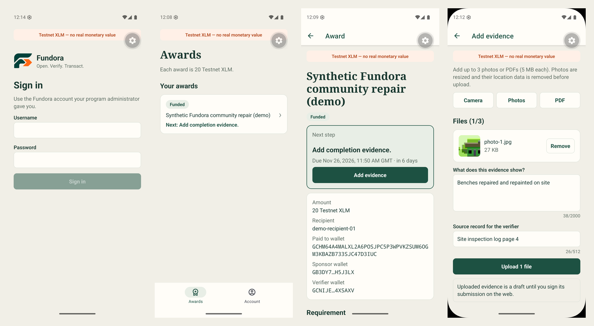

# Fundora mobile (Expo / React Native)

A Testnet-only phone app for Fundora that puts recipients first. Recipients sign in, see their awards, and add evidence from the camera, the photo library, or a PDF. Verifiers triage reviews and request changes; sponsors follow their awards. The app has a built-in Testnet wallet ([ADR-0003](../docs/decisions/0003-built-in-testnet-wallet.md)): create it on the Account tab, fund it with free Testnet XLM, and sign submissions, approvals and payment releases with your fingerprint or face. Signing runs in Rust ([`modules/fundora-signer`](modules/fundora-signer/README.md)), so the wallet needs the Android development or EAS build, not Expo Go. Other chain actions continue on the web. Change requests and disputes are shown on the award to its sponsor, verifier and recipient.

- Plan: [docs/mobile/MOBILE_APP_PLAN.md](../docs/mobile/MOBILE_APP_PLAN.md) · Roadmap: [docs/mobile/AGENT_ROADMAP.md](../docs/mobile/AGENT_ROADMAP.md) · Decision: [ADR-0002](../docs/decisions/0002-expo-mobile-client.md)
- Expo SDK 58 · React Native 0.88 · expo-router (native tabs) · TanStack Query · zod
- EAS project: `@jasperngo890/fundora`

## Screens



More: [after upload](../docs/mobile/screenshots/after-upload.png) · [verifier and dark mode](../docs/mobile/screenshots/verifier-and-dark-mode.png). Captured on the Pixel 9a emulator with synthetic demo data.

## Run it

1. The web server must allow mobile clients: set `MOBILE_BEARER_AUTH=1` in `web/.env.local` (or the hosted env) and restart it.
2. `cp .env.example .env.local` and set the API origin. The app needs no Supabase URL or key: sign-in and token refresh go through the Fundora server. A phone cannot reach `127.0.0.1`: use your laptop's LAN IP (`next dev -H 0.0.0.0`) or the hosted preview. Evidence upload URLs come from the server's Supabase project, so camera upload from a phone needs a Supabase instance the phone can reach.
3. `npm install`, then `npx expo start` and open the project in Expo Go (all native modules used here ship in Expo Go).

## Checks

```bash
npm run typecheck     # tsc --noEmit
npm run lint          # expo lint
npm test              # jest-expo: amount, status, evidence rules, upload pipeline
npx expo-doctor
maestro test -e USERNAME=<seeded recipient> -e PASSWORD=<seed password> .maestro/sign-in.yaml
```

The camera itself only works on a physical device. After uploading a camera photo, download it from the web app and confirm that `exiftool` shows no GPS fields.

## Builds and updates (EAS)

- `eas.json` profiles: `preview` (internal distribution: an Android APK, and iOS ad hoc builds that need registered devices) and `production` (store builds with auto-incremented build numbers; **store submission is not authorized**).
- Set the build-time variables once per environment: `eas env:create --environment preview --name EXPO_PUBLIC_API_BASE_URL --value <origin> --visibility plaintext`, and do the same for `EXPO_PUBLIC_WEB_BASE_URL`.
- First internal build: `npx eas-cli build --profile preview --platform android`.
- Versioning: `app.json` `version` is the user-facing semver (start 0.1.0). Build numbers are remote and automatic. `runtimeVersion` uses the fingerprint policy, so `eas update --channel preview` reaches only builds with matching native code.
